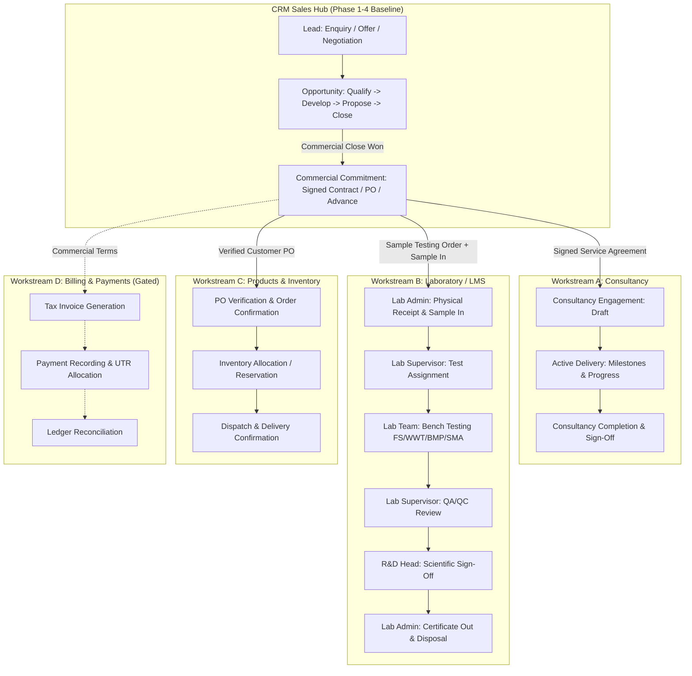

# PHASE 5 ARCHITECTURE AUDIT & REPOSITORY INVENTORY

> **Target Platform:** REVY Enterprise Portal  
> **Repository:** `Revy-Portal`  
> **Auditors:** Senior Software Architect, Database Architect, Business Analyst, QA Lead  
> **Audit Date:** 2026-10-27  
> **Audit Baseline:** Alembic Head `m0n1o2p3q4r5` | Git Commit `f57e2a8` (master) | 42 Passing Backend Tests | Clean Vite Build (1,993 modules)  
> **Scope:** Phase 5 Operations Discovery & Technical Assessment (Workstreams A through E)

---

## 1. Executive Summary

This architecture audit evaluates the operational readiness of the REVY Portal to expand from its stabilized **CRM Sales Hub** (Leads, Accounts, Contacts, Opportunities) into operational execution.

In accordance with the **Phase 5 Business-Policy Decision Record** ([`docs/phase5/PHASE5_DECISION_REGISTER.md`](file:///e:/IT%20Development/REVY%20Portal/Revy-Portal/docs/phase5/PHASE5_DECISION_REGISTER.md)), Phase 5 is planned across two distinct priority layers:
1. **Layer 1: Current Priority — Sales Hub:** Improve the Lead-to-Opportunity workflow, Quotation management section, Proforma Invoice (PI) architecture requirements, Opportunity outcomes (`Open`, `Won`, `Lost`), revenue visibility, and sales reporting across a Six-Stage Funnel.
2. **Layer 2: Future Priority — Operational Integration (Document Only):** Connect a `PO Received` Opportunity to operational workflows:
   - **Workstream A:** Consultancy Delivery (Contract execution, milestones, consultant assignment)
   - **Workstream B:** Sample Testing & Laboratory Operations (LMS Sample Incoming, bench testing FS/WWT/BMP/SMA, 3-tier approvals)
   - **Workstream C:** Product Orders & Inventory Management (SKU master, PO verification, stock allocation, dispatch)
   - **Workstream D:** Commercial Billing & Payments (Invoicing, taxation, receivables — Gated)
   - **Workstream E:** Cross-Module Integration Lifecycle (End-to-end handoff)

### Key Audit Finding & Scope Boundary
The repository contains early data models (`crm_consulting_engagements`, `crm_sample_submissions`, `crm_sample_tests`, `crm_testing_charges`, `crm_product_transactions`, `crm_milestones`) and an early prototype routing endpoint (`POST /crm/opportunities/{opp_id}/route-requirements`). However, **these tables represent commercial staging hooks within the CRM module, not full operational management systems**.

Crucially:
1. **Strict Scope Boundary:** The future operational workflow must NOT be implemented as part of the current Sales Hub scope. No LMS sample intake, Lab Order creation, inventory movement, invoice generation, or payment processing is authorized by the current decision record.
2. **LMS (Laboratory Management System)** exists at the platform level as an authoritative module (`LMS`) with pre-seeded module roles (`LMS_ADMIN`, `LMS_RD_HEAD`, `LMS_SUPERVISOR`, `LMS_TEAM`), but its operational database schema and UI are **unimplemented** (marked as "Coming Soon" in the Central Portal).
3. **IMS (Inventory Management System)** exists as an authoritative module (`IMS`), but has **no product catalogue/SKU master, no warehouse stock ledger, and no dispatch tracking**.
4. **Billing and Accounting** has **no backend schema** (no invoice, tax, payment, or receipt tables exist).
5. **Immediate Implementation Readiness:** The platform's file storage (`FileMetadata`), sequence generator (`CrmSequence`), and CRM models can immediately support the Layer 1 Sales Hub deliverables (Six-stage funnel, Quotations, Outcome & Revenue reporting) once decisions D-11 through D-14 are ratified by leadership.

---

## 2. Comprehensive Repository Inventory

### 2.1 Database Models & Tables

| Table Name | SQLAlchemy Model | Repository File Path | Current Status | Classification |
| :--- | :--- | :--- | :--- | :--- |
| `accounts` | `Account` | `backend/app/crm/model.py:27` | Active (32 accounts) | **Existing and Reusable** |
| `contacts` | `Contact` | `backend/app/crm/model.py:47` | Active (34 contacts) | **Existing and Reusable** |
| `leads` | `Lead` | `backend/app/crm/model.py:149` | Active (41 leads, PG CHECK constraint) | **Existing and Reusable** |
| `lead_requirement_types` | `LeadRequirementType` | `backend/app/crm/model.py:65` | Active (multi-select requirements) | **Existing and Reusable** |
| `lead_contact_methods` | `LeadContactMethod` | `backend/app/crm/model.py:80` | Active (contact channels) | **Existing and Reusable** |
| `lead_additional_contacts` | Table mapper | `backend/app/crm/model.py:97` | Active (secondary stakeholders) | **Existing and Reusable** |
| `lead_communication_history` | `LeadCommunicationHistory` | `backend/app/crm/model.py:257` | Active (`COM-00001` sequential logs) | **Existing and Reusable** |
| `crm_opportunities` | `Opportunity` | `backend/app/crm/model.py:105` | Active (15 opps, pipeline stages, `sub_status`) | **Existing and Reusable** |
| `crm_sequences` | `CrmSequence` | `backend/app/crm/model.py:278` | Active (`SELECT FOR UPDATE` atomic counter) | **Existing and Reusable** |
| `crm_consulting_engagements` | `ConsultingEngagement` | `backend/app/crm/model.py:291` | Prototype staging table (`ENG-00001`) | **Existing but Requiring Extension** |
| `crm_sample_submissions` | `SampleSubmission` | `backend/app/crm/model.py:336` | Prototype commercial sample table (`SMP-00001`) | **Existing but Requiring Extension** |
| `crm_sample_tests` | `SampleTestRequest` | `backend/app/crm/model.py:397` | Prototype test pricing table (`TST-00001`) | **Existing but Requiring Extension** |
| `crm_testing_charges` | `TestingChargeRecord` | `backend/app/crm/model.py:425` | Commercial charge calculation (`CHG-00001`) | **Existing but Requiring Extension** |
| `crm_product_transactions` | `ProductTransaction` | `backend/app/crm/model.py:460` | Prototype product quote/order table (`PRD-00001`) | **Existing but Requiring Extension** |
| `crm_milestones` | `Milestone` | `backend/app/crm/model.py:499` | General workstream milestone table (`MLS-00001`) | **Existing but Requiring Extension** |
| `files` | `FileMetadata` | `backend/app/files/model.py:9` | Generic polymorphic attachment table | **Existing and Reusable** |
| `notifications` | `Notification` | `backend/app/notifications/model.py:9` | Generic user notification table | **Existing and Reusable** |
| `audit_logs` | `AuditLog` | `backend/app/audit/model.py:9` | Enterprise audit trail with JSON before/after | **Existing and Reusable** |
| `users` | `User` | `backend/app/users/model.py:22` | Enterprise user identity table | **Existing and Reusable** |
| `modules` | `Module` | `backend/app/modules/model.py:11` | 9 core enterprise modules | **Existing and Reusable** |
| `module_roles` | `ModuleRole` | `backend/app/modules/model.py:23` | Scoped roles per module | **Existing and Reusable** |
| `user_module_memberships` | `UserModuleMembership` | `backend/app/modules/model.py:36` | User-to-module-role assignment | **Existing and Reusable** |
| `lms_*` (Lab operational) | *None* | *None* | **Missing** | **Missing** |
| `ims_*` (Inventory/SKU) | *None* | *None* | **Missing** | **Missing** |
| `billing_*` (Invoices/Taxes) | *None* | *None* | **Missing** | **Missing** |

---

### 2.2 API Endpoints & Schemas

| Endpoint | Method | Path in Codebase | Current Purpose & State | Workstream Relevance |
| :--- | :--- | :--- | :--- | :--- |
| `/crm/opportunities/{opp_id}/route-requirements` | `POST` | `backend/app/crm/router.py:495` | Dispatches Opportunity requirements into draft workstreams | Workstream E (Integration) |
| `/crm/opportunities/{opp_id}/workstreams` | `GET` | `backend/app/crm/router.py:510` | Lists routed workstreams for an Opportunity | Workstreams A, B, C |
| `/crm/milestones` | `GET`, `POST` | `backend/app/crm/router.py:526, 545` | CRUD for Opportunity & Workstream milestones | Workstream A (Consultancy) |
| `/crm/milestones/{id}` | `GET`, `PUT`, `DELETE` | `backend/app/crm/router.py:560, 574, 590` | Milestone lifecycle updates | Workstream A (Consultancy) |
| `/files/upload`, `/files/{id}` | *None* | *No router mounted* | Storage service exists, router missing | Workstreams A, B, C |
| `/notifications` | `GET`, `PUT` | `backend/app/notifications/router.py:16` | Fetches and marks read user notifications | Workstreams A through E |
| `/lms/status` | `GET` | `backend/app/modules/services_router.py:15` | Stub healthcheck returning 200/403 | Workstream B (Laboratory) |
| `/ims/status` | `GET` | `backend/app/modules/services_router.py:19` | Stub healthcheck returning 200/403 | Workstream C (Inventory) |

---

### 2.3 Frontend Pages & UI Components

| Route / Component | File Path | Current State | Reusability / Extension Notes |
| :--- | :--- | :--- | :--- |
| `/portal` (`CentralPortalPage`) | `frontend/src/pages/CentralPortalPage.jsx` | 9-card dashboard; LMS & IMS marked "Coming Soon" | Reusable; LMS & IMS cards can be enabled when modules go live |
| `/crm/opportunities` (`CrmOpportunitiesPage`) | `frontend/src/pages/CrmOpportunitiesPage.jsx` | Kanban & Table views, KPI summary metrics | Reusable; displays workstream count badge |
| `OpportunityDetailModal` | `frontend/src/modules/crm/components/OpportunityDetailModal.jsx` | Tabs for Details, Requirements, Workstreams, Milestones | Reusable; contains multi-requirement workstream routing UI |
| `/crm/leads/:id` (`CrmLeadDetailPage`) | `frontend/src/pages/CrmLeadDetailPage.jsx` | Lead detail with multiple linked opportunities | Reusable; Sales Hub baseline intact |
| `crmService.js` | `frontend/src/services/crmService.js` | API client methods for CRM, workstreams, milestones | Reusable; requires extension for operational actions |

---

### 2.4 Authentication, Authorization & User Management

| Component | File Path | Mechanism | Current Enforcement |
| :--- | :--- | :--- | :--- |
| JWT Bearer Authentication | `backend/app/core/dependencies.py:50` | `get_current_user` extracts JWT, verifies expiry, resolves User | Strictly enforced across all protected endpoints |
| Module Access Guard | `backend/app/core/dependencies.py:333` | `require_module_access(module_code)` checks `UserModuleMembership` | Active for `CRM`, `BMS`, `LMS`, `IMS`, `USERS` |
| Permission Guard | `backend/app/core/dependencies.py:256` | `require_permission(perm_code)` checks user permissions | Fine-grained RBAC on CRM and BMS endpoints |
| Role Priority & Aliasing | `backend/app/core/dependencies.py:198` | Resolves primary active role with IT Admin/Director superadmin override | IT Admin and Director bypass all permission checks |

---

## 3. Workstream Analysis: Detailed Discovery

### 3.1 Workstream A: Consultancy Delivery

#### Current State
- **Existing Model:** `ConsultingEngagement` (`crm_consulting_engagements`) defined in `backend/app/crm/model.py:291`.
  - Columns: `id`, `engagement_id` (`ENG-00001`), `account_id`, `contact_id`, `lead_id`, `opportunity_id`, `title`, `scope_description`, `contract_start_date`, `contract_end_date`, `duration_months`, `agreed_fee`, `billing_arrangement`, `status` (`Draft`, `Active`, `Completed`, `Terminated`, `Renewed`), `renewal_history`, `created_at`, `updated_at`.
- **Existing Service Logic:** `create_consulting_engagement` in `backend/app/crm/service.py:4213` and prototype routing in `route_opportunity_requirements` (`backend/app/crm/service.py:3503`).
- **Existing UI:** Displayed as a routed workstream card inside `OpportunityDetailModal.jsx:929`.

#### Identified Deficiencies & Gaps
1. **Commercial Commitment Authorization:** Currently, anyone with `crm.lead.edit` permission can route an Opportunity to create an `ENG-xxxxx` record in `Draft` status. There is no check verifying whether the Opportunity is `Won`, whether a signed agreement is attached, or whether upfront fees have been collected.
2. **Consultancy Durations:** The business requires three standard durations:
   - One-time consultancy
   - Six-month consultancy
   - One-year consultancy
   The current model has a free-text `duration_months` and `billing_arrangement`, but no database check constraint or enumeration enforcing these approved packages.
3. **Delivery Progress & Milestones:** Milestones exist in `crm_milestones`, but there is no structured deliverables tracking (e.g., Inception Report, Site Assessment, Process Audit, Final Engineering Recommendation) or formal client sign-off.
4. **Document Attachment:** No direct link between `ConsultingEngagement` and `FileMetadata` for client proposals, contracts, or deliverable reports.
5. **Ownership:** The model has `account_id`, `contact_id`, `lead_id`, `opportunity_id`, but **lacks an `assigned_lead_consultant_id`** (referencing `users.id`) for delivery accountability.

---

### 3.2 Workstream B: Sample Testing and Laboratory Operations

#### Current State
- **Existing CRM Staging Models:**
  - `SampleSubmission` (`crm_sample_submissions`): `sample_id` (`SMP-00001`), `account_id`, `contact_id`, `lead_id`, `opportunity_id`, `sample_description`, `sample_type`, `receipt_date`, `condition_on_receipt`, `status` (`Received`, `In-Testing`, `Completed`, `Failed`, `Contaminated`, `Spoiled`, `Unsuitable`, `Cancelled`), `sample_level_charge`, `is_unsuitable`, `failure_reason`, `stage_reached`, `work_performed`, `charge_decision`, `authorized_charge_amount`, `replacement_of_sample_id`.
  - `SampleTestRequest` (`crm_sample_tests`): `test_record_id` (`TST-00001`), `sample_id`, `test_name`, `test_type`, `unit_price`, `quantity`, `status` (`Pending`, `In-Progress`, `Completed`, `Cancelled`).
  - `TestingChargeRecord` (`crm_testing_charges`): `charge_id` (`CHG-00001`), `sample_charge_applied`, `tests_total`, `approved_additional_charges`, `applicable_discounts`, `final_calculated_total`, `billing_status`.
- **Existing Roles in DB:** `LMS_ADMIN`, `LMS_RD_HEAD`, `LMS_SUPERVISOR`, `LMS_TEAM` (defined in `backend/app/core/init_modules.py:129`).
- **Existing Module Stub:** `LMS` registered in `modules` table (`backend/app/core/init_modules.py:51`), but disabled (`is_active: False`).

#### Identified Deficiencies & Gaps
1. **Separation of Commercial Staging vs. Operational LIMS:**
   - The current `crm_sample_submissions` table resides entirely inside the `crm` schema.
   - Real laboratory operations require chain-of-custody tracking:
     - **Lab Admin:** Sample receipt, logging physical condition, assigning physical shelf/storage location, verifying sample integrity, generating internal bench barcode/tag.
     - **Lab Supervisor:** Reviewing incoming test requests, checking instrument availability, assigning specific tests to Lab Team analysts.
     - **Lab Team:** Entering raw bench observations, instrument readings, standard curves, and calculated results for the four required categories:
       1. **FS Characterization** (Faecal Sludge: TS, VS, COD, pH, moisture, pathogen indicators)
       2. **Wastewater Treatment** (BOD, COD, TSS, TDS, Total Nitrogen, Ammoniacal Nitrogen, Total Phosphorus, Heavy Metals)
       3. **BMP Analysis** (Biochemical Methane Potential: cumulative biogas yield, methane concentration %, kinetics curve)
       4. **SMA Analysis** (Specific Methanogenic Activity: substrate-specific activity of anaerobic sludge)
     - **Lab Supervisor Review:** Scientific validation of duplicate runs, calibration curves, and QA/QC blanks.
     - **R&D Head Approval:** Final executive sign-off authorizing certificate release.
     - **Lab Admin Sample-Out:** Returning preserved counter-samples or executing hazardous bio-waste disposal logging.
2. **Missing Operational Entities:**
   - No table for **Lab Test Results / Parameter Worksheets** (bench values, detection limits, units of measurement, reference standards).
   - No table for **Sample Chain of Custody & Disposal** (custody transfers, storage temperature logs, disposal methods, disposal sign-off).
   - No table for **Digital Certificate / Test Report** generation and revision history.
3. **Advance Payment Policy Boundary:**
   - Does physical receipt of a sample by Lab Admin require a confirmed payment receipt in CRM/Finance, or can samples be received and prepared in advance of testing authorization? (See Decision Register D-04).

---

### 3.3 Workstream C: Product Orders and Inventory

#### Current State
- **Existing Model:** `ProductTransaction` (`crm_product_transactions`) defined in `backend/app/crm/model.py:460`.
  - Columns: `id`, `transaction_id` (`PRD-00001`), `lead_id`, `account_id`, `contact_id`, `opportunity_id`, `product_name`, `sku_code`, `transaction_type` (`Recommendation`, `Quotation`, `Customer Commitment`, `Confirmed Order`), `status` (`Pending`, `Accepted`, `Invoiced`, `Cancelled`), `quantity`, `unit_of_measure`, `unit_rate`, `discount_amount`, `calculated_amount`, `currency`, `notes`.
- **Existing IMS Roles:** `IMS_ADMIN`, `IMS_INVENTORY_MANAGER`, `IMS_STORE_EXECUTIVE` in `backend/app/core/init_modules.py:135`.
- **Existing Module Stub:** `IMS` registered in `modules` table (`is_active: False`).

#### Identified Deficiencies & Gaps
1. **Purchase Order (PO) Verification:** The model has `transaction_type="Customer Commitment"`, but lacks fields for `customer_po_number`, `customer_po_date`, `po_document_file_id`, and `po_verified_by_user_id`. Under canonical business rules, **a verified customer purchase order is mandatory before an order can be confirmed**.
2. **Product Master / Catalogue:** Products are currently represented as arbitrary free-text strings (`product_name: VARCHAR(255)`) with an optional `sku_code`. There is no master `products` table defining:
   - Standard SKU codes
   - Standard product descriptions
   - Approved Units of Measure (litres, kg, metric tons, packs)
   - Minimum Order Quantities (MOQ)
   - Standard base price lists and tiered volume discounts
3. **Inventory Reservation & Stock Ledger:** There is no connection between confirmed orders and physical stock:
   - No warehouse/location tracking
   - No batch/lot tracking for bacterial inoculants, biological cultures, or nutrients
   - No stock allocation or reservation mechanism
   - No dispatch tracking (challan number, transport carrier, tracking ID, delivery confirmation)
4. **Repeat Orders:** Customers who previously purchased products cannot place a repeat order without either originating from a new Opportunity or manually creating a transaction. A streamlined Repeat Order workflow linked directly to an existing Account is needed.

---

### 3.4 Workstream D: Commercial Billing and Payments

#### Current State
- **Existing Capabilities:**
  - `crm_testing_charges` stores calculated testing charge totals.
  - `ConsultingEngagement.agreed_fee` and `billing_arrangement` store consultancy fees.
  - `ProductTransaction.calculated_amount` stores product order values.
  - BMS has an internal petty-cash money ledger (`breakfast_money_transactions`), but it is scoped strictly to daily meals and is not architected for commercial customer accounts.
- **Missing Capabilities:**
  - **Invoices:** No `invoices` or `invoice_line_items` tables exist.
  - **Sequential Numbering:** No tax-compliant invoice numbering format (e.g., `INV/2026-27/0001`).
  - **Taxation Engine:** No calculation of GST (CGST, SGST, IGST), TDS, or HSN/SAC codes.
  - **Payment Receipts:** No table tracking bank transfers, cheque receipts, UTR numbers, payment dates, or issuing banks.
  - **Payment Allocation:** No mechanism to link a payment receipt to one or more specific invoices, or to record customer advances.
  - **Credit Notes / Adjustments:** No refund or credit note tracking.

#### Scope Assessment
Commercial billing and payments represent a distinct financial accounting domain. Section 4, Workstream D of the project brief explicitly mandates:
> *"Treat billing as a potentially separate workstream whose scope must be explicitly approved. Do not invent accounting policies, tax rules, invoice-number formats, payment terms, or financial approvals."*

Therefore, Workstream D must be isolated into a dedicated roadmap phase (Phase 5D), gated on explicit finance leadership policy approvals.

---

### 3.5 Workstream E: Cross-Module Workflow and Integration

#### Current State
- The only existing cross-module integration is the prototype `POST /crm/opportunities/{opp_id}/route-requirements` endpoint.
- In `OpportunityDetailModal.jsx:877`, an enterprise safeguard warning states:
  > *"Enterprise Downstream Safeguard: Workstream routing creates draft operational links. Invoices, charges, or lab testing runs are strictly NOT auto-generated."*

#### Target Integration Lifecycle Paths

---

## 4. Capability Classification Matrix

| Capability Area | Component Name | Current Implementation Path | Classification | Required Action |
| :--- | :--- | :--- | :--- | :--- |
| **CRM Sales Hub** | Lead Lifecycle & Constraints | `backend/app/crm/model.py:149` | **Existing and Reusable** | Strictly preserve 6 approved statuses |
| **CRM Sales Hub** | Opportunity Pipeline & Substatus | `backend/app/crm/model.py:105` | **Existing and Reusable** | Strictly preserve pipeline stages and text substatus |
| **Platform** | User Identity & RBAC | `backend/app/core/dependencies.py` | **Existing and Reusable** | Reuse JWT, module membership, and permission decorators |
| **Platform** | Document Storage Engine | `backend/app/files/storage.py` | **Existing and Reusable** | Add missing API router and attach file metadata to workstreams |
| **Platform** | Audit Logging | `backend/app/audit/service.py` | **Existing and Reusable** | Emit audit events for all operational transitions |
| **Platform** | In-App Notifications | `backend/app/notifications/service.py` | **Existing and Reusable** | Trigger notifications for assignments and approvals |
| **Workstream A** | Consultancy Engagement Model | `backend/app/crm/model.py:291` | **Existing but Requiring Extension** | Add duration enum, consultant assignment, deliverables |
| **Workstream A** | Consultancy Milestones | `backend/app/crm/model.py:499` | **Existing but Requiring Extension** | Link milestones to engagement deliverables |
| **Workstream B** | Sample Submission Model | `backend/app/crm/model.py:336` | **Existing but Requiring Extension** | Retain as commercial intake; link to LMS bench records |
| **Workstream B** | Test Pricing & Calculations | `backend/app/crm/service.py:4290` | **Existing but Requiring Extension** | Support per-sample, per-test, and combined pricing rules |
| **Workstream B** | Laboratory Operational Workflow | *None* | **Missing** | Implement LMS operational tables, bench tests, and 3-tier approvals |
| **Workstream B** | Test Parameter Suites | *None* | **Missing** | Implement parameter models for FS, WWT, BMP, SMA |
| **Workstream C** | Product Transaction Staging | `backend/app/crm/model.py:460` | **Existing but Requiring Extension** | Add PO metadata, verified flag, and link to SKU master |
| **Workstream C** | Product SKU Master | *None* | **Missing** | Implement `products` master table with UoM, MOQ, price |
| **Workstream C** | Stock Ledger & Movements | *None* | **Missing** | Implement inventory tracking in IMS module |
| **Workstream D** | Invoicing & Tax Engine | *None* | **Missing** | Isolate to Phase 5D pending finance policy approval |
| **Workstream D** | Payment & Reconciliation | *None* | **Missing** | Isolate to Phase 5D pending finance policy approval |
| **Background Jobs** | Async Task Processing | *None* | **Missing** | All requests currently synchronous; evaluate for large report exports |

---

## 5. Architectural & Technical Risks

### 5.1 Module Boundary Confusion (CRM vs. LMS vs. IMS)
- **Risk:** Implementing bench testing, instrument logs, and warehouse stock movements directly inside `backend/app/crm/` violates modular boundaries and overburdens the CRM schema.
- **Mitigation Strategy:**
  - Keep commercial intent, customer orders, and quotes inside CRM.
  - Activate the existing `LMS` module (`backend/app/lms/`) for bench testing, quality review, and certificate generation.
  - Activate the existing `IMS` module (`backend/app/ims/`) for SKU stock balances and warehouse movements.
  - Bridge them via clear foreign key references (`originating_opportunity_id`, `crm_sample_submission_id`, `crm_product_order_id`).

### 5.2 Premature Downstream Data Mutation
- **Risk:** Qualifying a Lead or moving an Opportunity stage could accidentally generate operational tasks, test samples, or order commitments.
- **Mitigation Strategy:**
  - Maintain the established GSD barrier: **Leads and Opportunities represent sales intent, not operational execution**.
  - All operational entity creation must require an explicit, authorized business action accompanied by commercial prerequisites.

### 5.3 PostgreSQL Migration Compatibility
- **Risk:** Introducing complex constraints or schema modifications on the live Neon PostgreSQL database could cause downtime or lock production tables.
- **Mitigation Strategy:**
  - All Phase 5 schema changes must be delivered as clean, reversible Alembic migrations.
  - Migrations must strictly avoid data-destroying operations (e.g., column drops without safe staging).
  - Production migrations must contain zero test record inserts.

---

*End of Architecture Audit Document*
